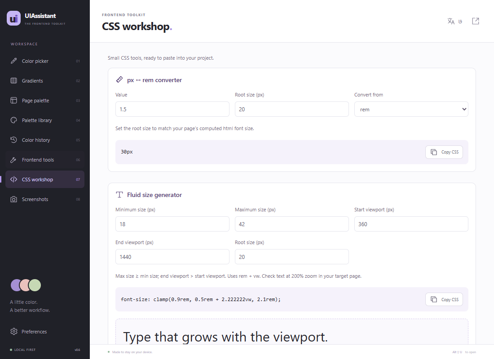
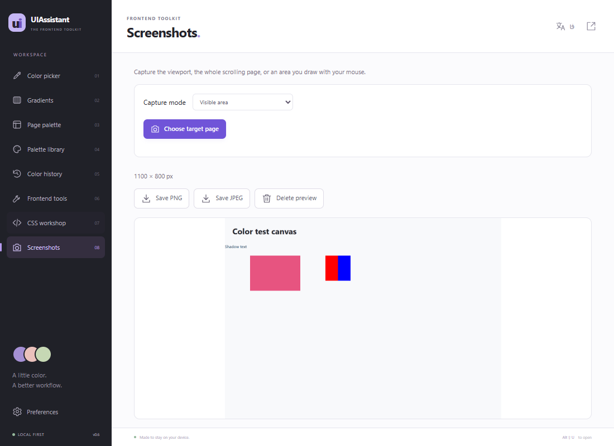
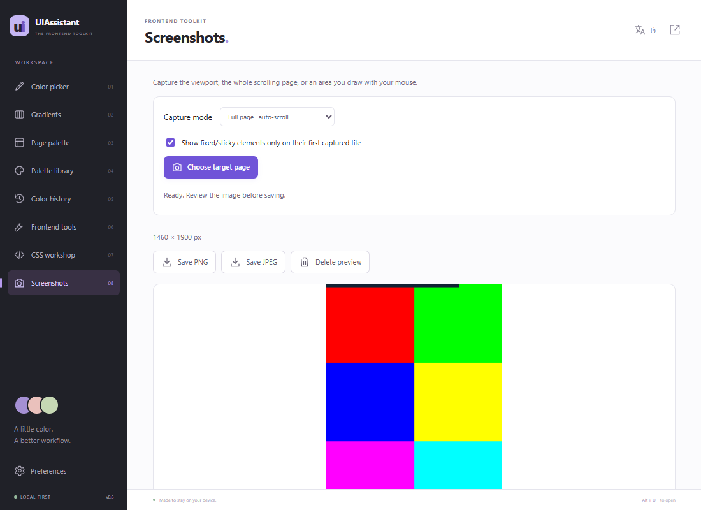
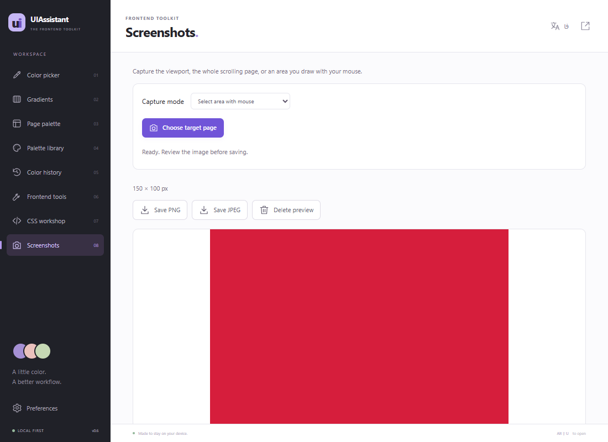

# UIAssistant

**مجموعه‌ابزار محلی فرانت‌اند برای Chrome، Edge و Firefox.** انتخاب و کپی خودکار رنگ، بررسی ظاهر عناصر، اندازه‌گیری فاصله، بررسی چیدمان و استخراج توکن‌های طراحی.

[English](README.md) · **فارسی**

[آخرین انتشار](https://github.com/salehghotbani/UIAssistant/releases/latest) · [مشارکت](CONTRIBUTING.fa.md) · [حریم خصوصی](PRIVACY.fa.md) · [امنیت](SECURITY.fa.md) · [مجوز MIT](LICENSE.fa.md)


## امکانات

| ابزار             | قابلیت‌ها                                                                                                                                            |
| ----------------- | ---------------------------------------------------------------------------------------------------------------------------------------------------- |
| قطره‌چکان صفحه    | نمونه‌گیری از پیکسل واقعی تصویر صفحه، ذره‌بین، اندازه‌های ۱، ۳، ۵، ۱۱ و ۲۵ پیکسل، میانگین ناحیه، تازه‌سازی رنگ hover و برداشت دوباره از محل قبلی     |
| ویرایشگر رنگ      | صفحه‌های H/S/V و R/G/B، آلفا و ورودی CSS؛ **هر رنگ انتخاب‌شده خودکار کپی می‌شود**؛ خروجی HEX، HEX با آلفا، RGB(A)، HSL(A) و متغیر CSS                |
| رنگ‌های صفحه      | تحلیل رنگ و افکت‌های محاسبه‌شدهٔ DOM، فراوانی، فیلتر، یافتن عنصر و ذخیرهٔ پالت                                                                       |
| پالت و تاریخچه    | ۷ پالت آماده، مجموعه‌های شخصی، ورود JSON و GIMP GPL، خروجی JSON/CSS و ۲۰۰ رنگ یکتای اخیر                                                             |
| گرادیان           | خطی، شعاعی، مخروطی و تکراری؛ نقاط مستقل رنگ و شفافیت؛ الگوها؛ تنظیم hue/saturation/lightness؛ ورود CSS/تصویر؛ خروجی CSS/SCSS، PNG و SVG پشتیبانی‌شده |
| بازرسی عنصر       | ابعاد، margin/padding، border، radius، shadow و کپی CSS                                                                                              |
| تایپوگرافی        | خانواده، اندازه، وزن و سبک فونت، line-height، فاصلهٔ حروف و تراز متن از CSS                                                                          |
| خط‌کش             | انتخاب دو عنصر برای اندازه‌گیری فاصلهٔ افقی/عمودی و اختلاف مختصات با واحد CSS pixel                                                                  |
| بررسی چیدمان      | یافتن بیرون‌زدگی افقی، محتوای بریده و متن کوتاه‌شده                                                                                                  |
| بررسی کنتراست     | محاسبهٔ متن روی ترکیب پس‌زمینه‌های ساده، پیشنهاد رنگ مناسب AA و علامت‌گذاری موارد پیچیده برای بررسی دستی                                             |
| توکن‌های طراحی    | مقدار و فراوانی رنگ، تایپوگرافی، فاصله، radius و shadow؛ خروجی متغیر CSS یا JSON                                                                     |
| تصویر مرجع        | ورود محلی PNG/JPEG/WebP، تنظیم شفافیت، مختصات و عرض و جابه‌جایی با ماوس                                                                              |
| اصول دسترس‌پذیری  | بررسی مقدماتی متن جایگزین تصویر، نام کنترل‌ها، زبان صفحه و ترتیب عنوان‌ها؛ خروجی گزارش JSON                                                          |
| کارگاه CSS        | تبدیل px/rem با ریشهٔ دلخواه، ساخت اندازهٔ واکنش‌گرا با `clamp()` و پیش‌نمایش عرض، ساخت سایه با آلفا و حالت داخلی و کپی CSS                          |
| عکس از صفحه       | بخش نمایان، تمام صفحه با اسکرول و اتصال تصاویر، یا ناحیهٔ انتخابی با ماوس؛ تأیید هدف، پیش‌نمایش محلی و ذخیرهٔ دستی PNG/JPEG؛ بدون تاریخچهٔ عکس       |
| پیش‌نمایش RTL/LTR | تغییر موقت جهت، بررسی چیدمان و بازگردانی دقیق جهت و اولویت استایل قبلی                                                                               |

رابط فارسی و انگلیسی، پنجرهٔ فشرده و فضای کار بزرگ در دسترس‌اند. با **فا / EN** زبان را عوض کنید.

## تصاویر










تصاویر از رابط واقعی و صفحهٔ آزمایشی محلی گرفته شده‌اند و دادهٔ مرور شخصی ندارند؛ [منبع تصاویر](docs/images/README.md).

## نصب

برای استفاده از بستهٔ انتشار نیازی به Node.js نیست. این بسته‌ها **نسخهٔ توسعه‌دهنده و بدون امضای فروشگاه** هستند.

| مرورگر         | حداقل نسخه | فایل                      |
| -------------- | ---------- | ------------------------- |
| Chrome         | ۱۱۶        | `UIAssistant.zip`         |
| Edge           | ۱۱۶        | `UIAssistant.zip`         |
| Firefox دسکتاپ | ۱۴۰        | `UIAssistant-firefox.zip` |

### Chrome و Edge

۱. فایل `UIAssistant.zip` را از [انتشارها](https://github.com/salehghotbani/UIAssistant/releases/latest) بگیرید و استخراج کنید.
۲. در `chrome://extensions` یا `edge://extensions` گزینهٔ **Developer mode** را روشن کنید.
۳. **Load unpacked** را بزنید و پوشه‌ای را انتخاب کنید که `manifest.json` مستقیماً در آن قرار دارد.
۴. افزونه را پین کنید و برای استفاده از ابزارهای صفحه، یک وب‌سایت معمولی باز کنید.

با ساخت از سورس، پوشهٔ قابل نصب در `dist/UIAssistant` ایجاد می‌شود.

### Firefox

۱. بستهٔ `UIAssistant-firefox.zip` را بگیرید.
۲. به `about:debugging#/runtime/this-firefox` بروید و **Load Temporary Add-on** را انتخاب کنید.
۳. فایل ZIP یا `manifest.json` داخل پوشهٔ استخراج‌شده را انتخاب کنید.

نصب موقت پس از راه‌اندازی دوبارهٔ Firefox حذف می‌شود. نصب دائمی روی Firefox استاندارد به امضای Mozilla نیاز دارد؛ این انتشار **بدون امضا** است. [راهنمای Mozilla](https://extensionworkshop.com/documentation/develop/temporary-installation-in-firefox/). ساخت از سورس پوشهٔ `dist/UIAssistant-firefox` را ایجاد می‌کند. قطره‌چکان صفحه در Firefox فعال است؛ دکمهٔ EyeDropper بومی برای انتخاب بیرون مرورگر در آن در دسترس نیست.

### به‌روزرسانی

فایل‌های استخراج‌شده را جایگزین و افزونه و صفحهٔ مورد بررسی را Reload کنید تا ابزارهای تزریق‌شدهٔ قدیمی پاک شوند. معمولاً دادهٔ نصب فعلی هنگام Reload باقی می‌ماند؛ پیش از حذف و نصب مجدد، پالت‌های مهم را خروجی بگیرید.

## روش استفاده

- **کپی رنگ:** انتخاب از صفحه ← کلیک روی پیکسل؛ مقدار در قالب انتخابی کپی و در تاریخچه ثبت می‌شود.
- **بازرسی:** ابزارهای فرانت‌اند ← بازرسی عنصر یا تایپوگرافی ← انتخاب عنصر؛ CSS از پنل روی صفحه یا فضای کار قابل کپی است.
- **اندازه‌گیری:** خط‌کش ← انتخاب دو عنصر؛ فاصله و اختلاف مختصات نمایش داده می‌شود.
- **بررسی و استخراج:** بررسی چیدمان، کنتراست یا توکن‌های طراحی؛ عنصر مرتبط را پیدا یا CSS/JSON را دریافت کنید.
- **عکس از صفحه:** نوع عکس را انتخاب کنید: بخش نمایان، تمام صفحه یا انتخاب ناحیه با ماوس؛ سپس هدف را انتخاب، آدرس را بررسی و تا ۳۰ ثانیه تأیید کنید. حالت کامل/ناحیه از popup در فضای کار بزرگ باز می‌شود. برای ناحیه، روی سایت کادر بکشید؛ برای تمام صفحه تب را فعال نگه دارید. Esc یا لغو عملیات را متوقف و موقعیت اسکرول و استایل‌ها را برمی‌گرداند. سپس پیش‌نمایش و ذخیرهٔ دستی PNG/JPEG در دسترس است.
- **ساخت CSS:** کارگاه CSS ← تبدیل px/rem، ساخت اندازه بین دو عرض صفحه یا تنظیم سایه؛ خروجی را کپی کنید. اندازهٔ ریشه را خودتان وارد می‌کنید و تغییری در صفحهٔ مقصد نمی‌دهد.
- **اصول دسترس‌پذیری:** متن جایگزین، نام کنترل‌ها و ترتیب عنوان‌ها را بررسی و گزارش JSON را دریافت کنید. نتیجه‌ها بررسی انسانی می‌خواهند؛ `alt=""` تزئینی و کنترل‌های برچسب‌دار پذیرفته می‌شوند.
- **مقایسهٔ طرح:** تصویر محلی را انتخاب، شفافیت/موقعیت/عرض را تنظیم و در صورت نیاز جابه‌جایی را فعال کنید. تصویر نسبت به viewport ثابت می‌ماند.
- **بازگردانی:** بازگردانی صفحه لایه‌ها را حذف و جهت و اولویت inline را برمی‌گرداند. Reload هم تغییرهای موقت را پاک می‌کند. Esc انتخاب و تصویر مرجع را می‌بندد.

## میان‌برها

| کلید                     | عملکرد                                           |
| ------------------------ | ------------------------------------------------ |
| `Alt+Shift+U`            | بازکردن افزونه؛ در حالت یک‌کلیکی، شروع قطره‌چکان |
| `Alt+Shift+C`            | انتخاب رنگ صفحه                                  |
| `Alt+Shift+R`            | نمونه‌گیری دوباره از محل قبلی                    |
| جهت‌ها / Shift همراه جهت | حرکت ۱ / ۱۰ پیکسل CSS                            |
| Enter                    | تأیید رنگ                                        |
| + / -                    | اندازهٔ نمونه                                    |
| Space                    | تازه‌سازی تصویر                                  |
| Esc                      | لغو نمونه‌گیری یا بستن انتخاب                    |

تنظیم میان‌برها: `chrome://extensions/shortcuts`، `edge://extensions/shortcuts` یا **Manage Extension Shortcuts** در `about:addons` فایرفاکس. در حالت یک‌کلیکی، فضای کار از **Open UIAssistant** در اعلان نتیجه باز می‌شود.

## حریم خصوصی

بدون حساب، آمارگیری، کد خارجی، فونت CDN یا درخواست به سرور برنامه. داده‌ها در پروفایل مرورگر باقی می‌مانند؛ تصاویر محلی پردازش می‌شوند. آخرین نتیجهٔ بازرسی/اندازه‌گیری محلی ذخیره می‌شود تا با بسته‌شدن پنجره از دست نرود.

مجوزها: `activeTab`، `scripting`، `storage` و `clipboardWrite`؛ در Chromium همچنین `offscreen`. بستهٔ انتشار مجوز دائمی همهٔ سایت‌ها یا خواندن کلیپ‌بورد ندارد. [جزئیات فارسی](PRIVACY.fa.md) · [English](PRIVACY.md).

[گزارش امنیتی](SECURITY.fa.md) اصلاحات، محدودیت در برابر اتوماسیون دارای دسترسی سیستم و هشدار حل‌نشدهٔ ابزار توسعه را توضیح می‌دهد. پیش‌نمایش عکس فقط در صفحهٔ باز افزونه می‌ماند؛ ذخیره دستی است و مجوز موقت در session نگه‌داری می‌شود.

## توسعه

Node.js نسخهٔ ۲۰ به بعد و npm لازم‌اند؛ نسخهٔ آزمایش‌شدهٔ محلی Node.js 24 است.

```sh
npm ci
npm test
npm run check
npm run format:check
npm run build
npm run lint:firefox
```

- `npm run preview`: پیش‌نمایش رابط در `http://127.0.0.1:4173`؛ ابزارهای صفحه به نصب افزونه نیاز دارند.
- `npm run test:browser`: تست یکپارچه در Edge مجزا و headless ویندوز؛ با `BROWSER_PATH` مسیر مرورگر Chromium سازگار را تعیین کنید. نتیجه در `artifacts/` ذخیره می‌شود.
- `npm run format`: قالب‌بندی کد و مستندات پروژه.
- ساخت، دو ZIP و پوشه‌های مستقل Chrome/Edge و Firefox را در `dist/` ایجاد می‌کند. manifest فایرفاکس از manifest منبع Chromium تولید می‌شود.

[راهنمای مشارکت](CONTRIBUTING.fa.md) شامل معماری، تست، ترجمه و انتشار است.

## بررسی‌ها و محدودیت‌ها

- ۳۹ تست محاسباتی/سازگاری/امنیت و تست یکپارچهٔ Edge برای ابزارهای رنگ، ۹ ابزار فرانت‌اند، کارگاه CSS، کلیپ‌بورد واقعی و خروجی گزارش وجود دارد. برش در زوم ۱۲۵٪، اتصال تصویر کامل، بازگردانی پس از خطا/لغو، رد درخواست خارجی و ورودی جعلی نیز تست می‌شوند. هر ۸ صفحه و ۴ پنجره در دو زبان و اندازه‌های ۷۹۰×۶۰۰، ۱۱۰۰×۸۰۰ و ۴۸۰×۸۰۰، با اسکرول برای بررسی فاصلهٔ دکمه‌ها و بیرون‌زدگی پایین صفحه بررسی می‌شوند. Firefox با web-ext اعتبارسنجی شده، ولی اجرای واقعی آن در این محیط **تست نشده است**. EyeDropper بومی و میان‌برهای مرورگر بررسی دستی می‌خواهند.
- مجوز همهٔ سایت‌ها و خواندن کلیپ‌بورد فقط به **کپی آزمایشی** headless داده می‌شود و وارد انتشار نمی‌شود. کد ثالثِ بدون تغییر `vendor/` از بررسی heuristic ابزار Mozilla کنار گذاشته می‌شود.
- صفحات حفاظت‌شده و فروشگاه‌ها ممکن است تزریق را نپذیرند؛ `file://` به اجازهٔ مرورگر نیاز دارد. سقف تحلیل رنگ ۳۰٬۰۰۰ عنصر و بررسی فرانت‌اند ۱۰٬۰۰۰ عنصر با نمایش ۱٬۰۰۰ یافته است. Shadow DOM بسته و DOM فریم با مبدأ دیگر در دسترس نیستند؛ بررسی فرانت‌اند وارد iframe نمی‌شود.
- اطلاعات فونت از CSS است و فایل واقعی رندر هر گلیف را تأیید نمی‌کند. بررسی کنتراست ممیزی کامل WCAG نیست؛ تصویر، گرادیان، opacity/filter/blending، پس‌زمینهٔ نامطمئن، هم‌پوشانی و متن تصویر بررسی بصری می‌خواهند. بیرون‌زدگی عمدی هم ممکن است گزارش شود.
- اصول دسترس‌پذیری از قواعد مقدماتی DOM و نام‌گذاری استفاده می‌کند و الگوریتم کامل نام قابل‌دسترسی یا تأیید انطباق WCAG نیست. محتوای مخفی و فریم‌ها بررسی نمی‌شوند؛ پرش سطح عنوان نیازمند بازبینی است. [بررسی مقدماتی WAI](https://www.w3.org/WAI/test-evaluate/preliminary/) · [برچسب فرم‌ها](https://www.w3.org/WAI/tutorials/forms/labels/). اندازهٔ واکنش‌گرا با [CSS clamp](https://developer.mozilla.org/en-US/docs/Web/CSS/Reference/Values/clamp) و rem + vw ساخته می‌شود؛ زوم متن را در صفحهٔ مقصد بررسی کنید.
- RTL/LTR درستی معنایی alignment و ترتیب خواندن را تضمین نمی‌کند. اندازه‌ها بر اساس کادرهای موازی محورند. Resample به صفحه، اسکرول، viewport و zoom یکسان نیاز دارد.
- حداکثر ۶۴ نقطهٔ رنگ و ۶۴ شفافیت؛ استخراج تصویر تقریبی و حداکثر ۳۲ نقطه است. ورودی CSS درصد و هندسهٔ مرکزیِ پشتیبانی‌شده را می‌پذیرد. SVG برای خطی/شعاعی غیرتکراری است و PNG/CSS انواع دیگر را پوشش می‌دهند. پیوند گرادیان مخصوص همان نصب است. خروجی‌های منسوخ Flash، IE6–8 و Compass پیاده‌سازی نشده‌اند.
- عکس کامل سند اسکرول اصلی را ثبت می‌کند و نواحی اسکرول داخلی را باز نمی‌کند. سقف: ۶۴ بخش، ۲۴ مگاپیکسل، ضلع ۳۲٬۷۶۰ پیکسل، PNG تا ۲۴MB و دو دقیقه. صفحات بی‌نهایت/مجازی یا با ابعاد متغیر نیازمند ثبت دستی یا تکرارند. جلوگیری از تکرار fixed/sticky اختیاری است و shadow بسته را بررسی نمی‌کند؛ حرکت و ویدئو ممکن است بین بخش‌ها تفاوت داشته باشند.
- تصویر مرجع PNG/JPEG/WebP تا ۱۲MB پذیرفته و با بعد حداکثر ۲۰۴۸ پیکسل پردازش می‌شود؛ آپلود یا در تاریخچه ذخیره نمی‌شود.

## مشارکت و مجوز

گزارش باگ، PR متمرکز، ترجمه و بازخورد دسترس‌پذیری پذیرفته می‌شود؛ [راهنمای مشارکت](CONTRIBUTING.fa.md) را بخوانید.

کد، مستندات و تصاویر پروژه تحت [MIT](LICENSE) هستند. [ترجمهٔ فارسی](LICENSE.fa.md) برای اطلاع است؛ متن انگلیسی معتبر است. DOMPurify مجوز اصلی خود را دارد؛ [اعلان‌های ثالث](THIRD_PARTY_NOTICES.md).

UIAssistant پیاده‌سازی مستقلی با الهام از [قابلیت‌های مستند ColorZilla](https://www.colorzilla.com/chrome/features) است؛ کد، برند و دارایی‌های آن در این مخزن نیستند.
