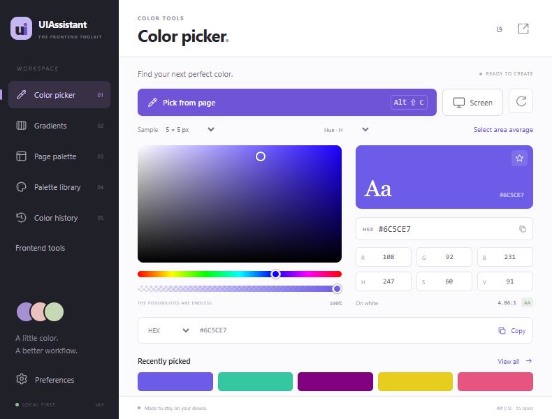
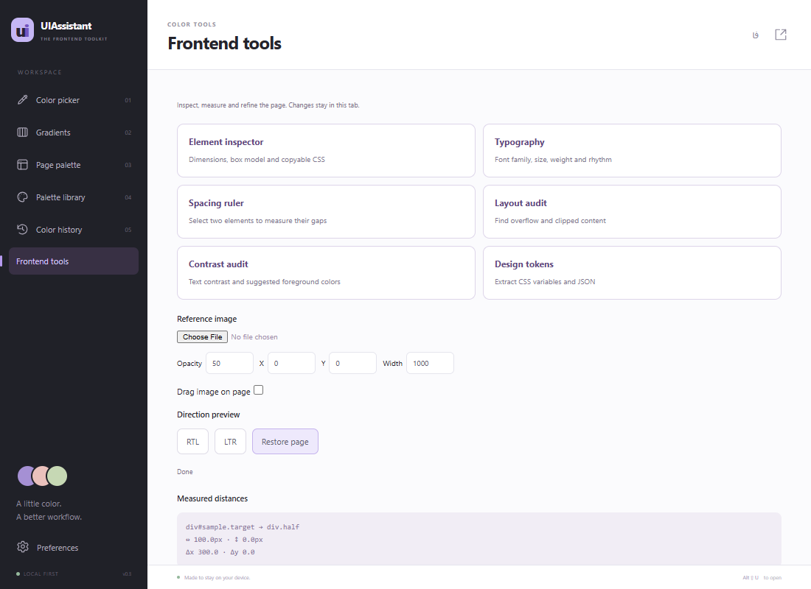
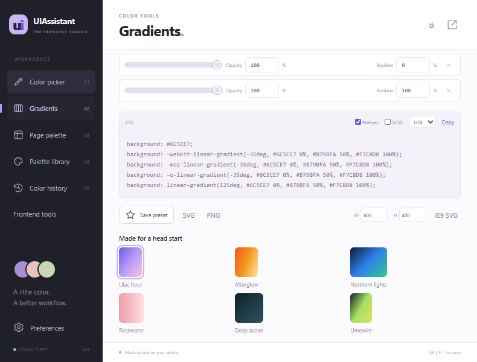
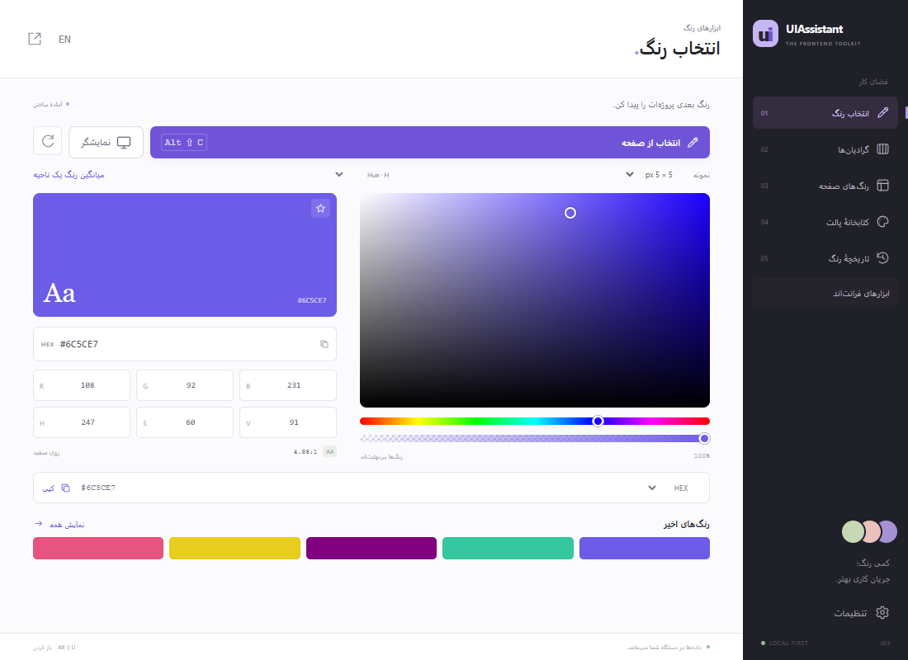

# UIAssistant

**A local-first frontend toolkit for Chrome, Edge and Firefox.** Pick and automatically copy colors, inspect styles, measure spacing, audit layouts and export design tokens.

**English** · [فارسی](README.fa.md)

[Latest release](https://github.com/salehghotbani/UIAssistant/releases/latest) · [Contributing](CONTRIBUTING.md) · [Privacy](PRIVACY.md) · [MIT License](LICENSE)



## Features

| Tool                | Capabilities                                                                                                                                                                            |
| ------------------- | --------------------------------------------------------------------------------------------------------------------------------------------------------------------------------------- |
| Page eyedropper     | Real screenshot pixels, magnifier, 1×1/3×3/5×5/11×11/25×25 sampling, area average, dynamic hover refresh, previous-location resampling.                                                 |
| Color editor        | H/S/V and R/G/B component planes, alpha and CSS color input. **Every color selection is copied automatically** in the chosen HEX, HEX-alpha, RGB(A), HSL(A) or CSS-variable format.     |
| Page palettes       | Computed DOM colors and effects, frequency counts, filtering, element location and saved page palettes.                                                                                 |
| Library and history | Seven built-in palettes, custom collections, JSON/GIMP GPL import, JSON/CSS export and 200 unique recent colors.                                                                        |
| Gradients           | Linear/radial/conic and repeating gradients; independent color/opacity stops; presets; hue/saturation/lightness adjustments; CSS/image import; CSS/SCSS, PNG and supported SVG exports. |
| Element inspector   | Dimensions, margin/padding, border, radius, shadow and copyable CSS.                                                                                                                    |
| Typography          | Computed font family, size, weight, style, line height, letter spacing and alignment.                                                                                                   |
| Spacing ruler       | Select two elements for horizontal/vertical gaps and coordinate offsets in CSS pixels.                                                                                                  |
| Layout audit        | Locate horizontal overflow, clipped content and truncated text.                                                                                                                         |
| Contrast audit      | Text against composited flat ancestor backgrounds; AA-oriented foreground suggestions; manual-review flags for complex cases.                                                           |
| Design tokens       | Extract color, typography, spacing, radius and shadow values/frequencies; export CSS variables or JSON.                                                                                 |
| Reference overlay   | Local PNG/JPEG/WebP image, adjustable opacity, coordinates, width and dragging.                                                                                                         |
| RTL/LTR preview     | Temporary direction changes with layout checks and exact direction/style restoration.                                                                                                   |

English and Persian interfaces, RTL layout, compact popup and expanded workspace are included. Use **فا / EN** to switch languages.

## Screenshots

### Frontend workspace



### Gradient editor



### Persian workspace



These are actual browser captures from a local fixture, not mockups or personal browsing screenshots. See [image provenance](docs/images/README.md).

## Install

No Node.js is needed to use the release packages. These are **developer builds**, not store-signed extensions.

| Browser         | Minimum | Download                  |
| --------------- | ------- | ------------------------- |
| Chrome          | 116     | `UIAssistant.zip`         |
| Microsoft Edge  | 116     | `UIAssistant.zip`         |
| Firefox desktop | 140     | `UIAssistant-firefox.zip` |

### Chrome / Edge

1. Download `UIAssistant.zip` from [Releases](https://github.com/salehghotbani/UIAssistant/releases/latest) and extract it.
2. Open `chrome://extensions` or `edge://extensions`; enable **Developer mode**.
3. Select **Load unpacked**, then the extracted folder containing `manifest.json` directly.
4. Pin UIAssistant and open a normal website to use page tools.

For a source checkout, `npm run build` produces the loadable folder `dist/UIAssistant`.

### Firefox

1. Download `UIAssistant-firefox.zip`.
2. Open `about:debugging#/runtime/this-firefox` → **Load Temporary Add-on**.
3. Select the ZIP, or extract it and select its `manifest.json`.

Temporary installation ends when Firefox restarts. Permanent installation in standard Firefox requires Mozilla signing; this release is **unsigned**. See [Mozilla's guide](https://extensionworkshop.com/documentation/develop/temporary-installation-in-firefox/). Source builds produce `dist/UIAssistant-firefox`. Firefox has the page eyedropper; the native screen-wide EyeDropper button is unavailable there.

### Updating

Replace the extracted files, reload the extension and reload inspected pages to clear old injected tools. Storage normally remains when reloading the same extension; export important palettes before removing or reinstalling it.

## Workflows

- **Copy a color:** Pick from page → click a pixel. The value is copied in the selected format and saved in history.
- **Inspect:** Frontend tools → Element inspector or Typography → select an element. Copy CSS from the page panel or workspace.
- **Measure:** Spacing ruler → select two elements. Read gaps and coordinate differences.
- **Audit/export:** Layout audit, Contrast audit or Design tokens → locate findings or download CSS/JSON.
- **Compare:** Choose a local reference image, adjust its opacity/position/width and enable dragging if needed. The image is fixed relative to the viewport.
- **Undo:** Restore page removes tool layers and restores the original direction and inline priority. Reload also clears temporary changes. Esc closes selection/reference overlays.

## Shortcuts

| Key                     | Action                                                |
| ----------------------- | ----------------------------------------------------- |
| `Alt+Shift+U`           | Open the extension; sample directly in one-click mode |
| `Alt+Shift+C`           | Start page sampling                                   |
| `Alt+Shift+R`           | Resample the previous location                        |
| Arrows / Shift + arrows | Move the sample 1 / 10 CSS pixels                     |
| Enter                   | Confirm a color                                       |
| + / -                   | Change sample size                                    |
| Space                   | Refresh capture                                       |
| Esc                     | Cancel sampling or close selection                    |

Configure at `chrome://extensions/shortcuts`, `edge://extensions/shortcuts`, or **Manage Extension Shortcuts** in Firefox's `about:addons`. In one-click mode, reopen the workspace through **Open UIAssistant** in the sample-result notification.

## Privacy

No accounts, analytics, remote code, CDN fonts or application-server requests. Data stays in the browser profile. Reference images and screenshot pixels are processed locally. The last element inspection/measurement is saved locally to survive closing the popup.

Permissions: `activeTab`, `scripting`, `storage`, `clipboardWrite`, plus Chromium-only `offscreen`. Release manifests have no persistent all-sites permission or clipboard-read permission. See [PRIVACY.md](PRIVACY.md) ([فارسی](PRIVACY.fa.md)).

## Development

Node.js 20+ and npm are required; Node.js 24 is locally validated.

```sh
npm ci
npm test
npm run check
npm run format:check
npm run build
npm run lint:firefox
```

- `npm run preview`: UI preview at `http://127.0.0.1:4173`; page tools require installation.
- `npm run test:browser`: isolated headless Edge integration tests on Windows. Override `BROWSER_PATH` for a compatible Chromium executable. Outputs go to ignored `artifacts/`.
- `npm run format`: format first-party code and documentation.
- Build produces `dist/UIAssistant.zip`, `dist/UIAssistant-firefox.zip` and their unpacked folders. Firefox's manifest is generated from the Chromium source manifest.

Read [CONTRIBUTING.md](CONTRIBUTING.md) for architecture, testing, translation and release details.

## Validation and limits

- There are 20 unit/compatibility tests and an Edge integration suite covering color tools and all eight frontend tools. Firefox passes `web-ext` validation; actual Firefox execution has **not** been tested in this environment. Native screen selection and shortcut assignment require manual testing.
- The headless harness grants all-sites and clipboard-read only to an isolated **test copy**. Neither grant enters a release. Unmodified third-party `vendor/` code is excluded from heuristic Mozilla scanning.
- Protected browser/store pages may reject injection; `file://` needs browser-granted file access. Page-color scans cap at 30,000 elements. Frontend scans cap at 10,000 and show up to 1,000 findings. Closed shadow roots and cross-origin frame DOM are inaccessible; frontend audits do not traverse iframes.
- Typography reports computed CSS, not the actual font file used for each glyph. Contrast is not a complete WCAG audit: images, gradients, opacity/filter/blending, uncertain canvas backgrounds, sibling occlusion and image text need visual review. Intentional overflow may be reported.
- RTL/LTR previews do not prove semantic alignment or reading order. Measurements use axis-aligned bounding rectangles. Resampling needs the same page, scroll, viewport and zoom.
- Gradients support up to 64 color and 64 opacity stops; image extraction is approximate and generates at most 32 stops. CSS import supports percentage stops and supported centered geometry. SVG export supports non-repeating linear/radial gradients; PNG/CSS cover other types. Local gradient links belong to the same extension installation. Obsolete Flash, IE6–8 and Compass-specific outputs are not implemented.
- Reference uploads accept PNG/JPEG/WebP up to 12 MB and are decoded at a maximum dimension of 2,048 pixels. They are not uploaded or saved in history.

## Contributing and license

Reports, focused pull requests, translations and accessibility feedback are welcome. Read [the contribution guide](CONTRIBUTING.md) ([فارسی](CONTRIBUTING.fa.md)).

First-party code, documentation and screenshots use [MIT](LICENSE). [LICENSE.fa.md](LICENSE.fa.md) is an informational translation; English controls. DOMPurify retains its upstream license: [third-party notices](THIRD_PARTY_NOTICES.md).

UIAssistant independently implements tools inspired by [ColorZilla's documented features](https://www.colorzilla.com/chrome/features). ColorZilla source, branding and assets are not included.
